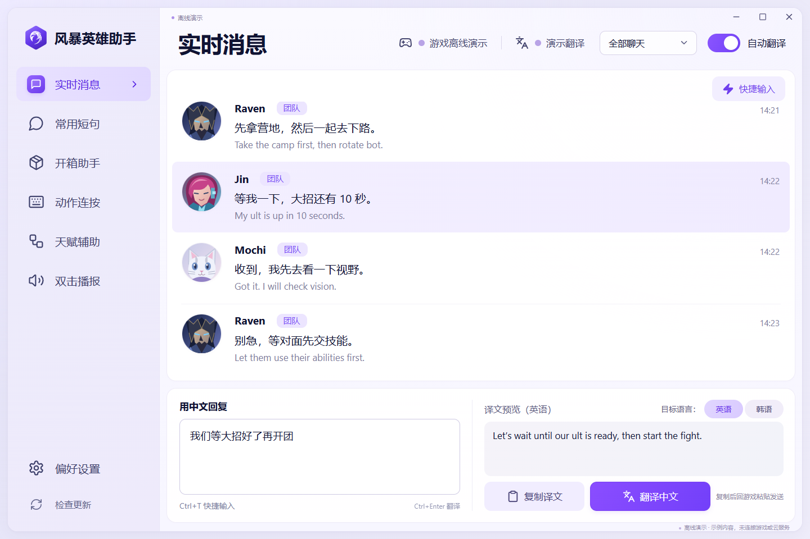
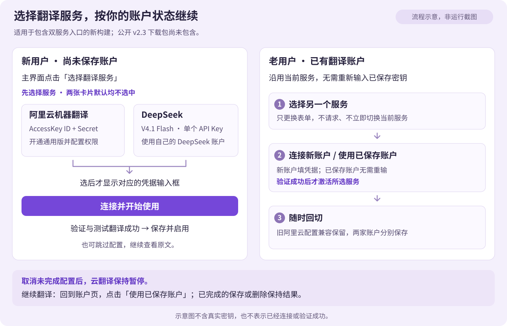
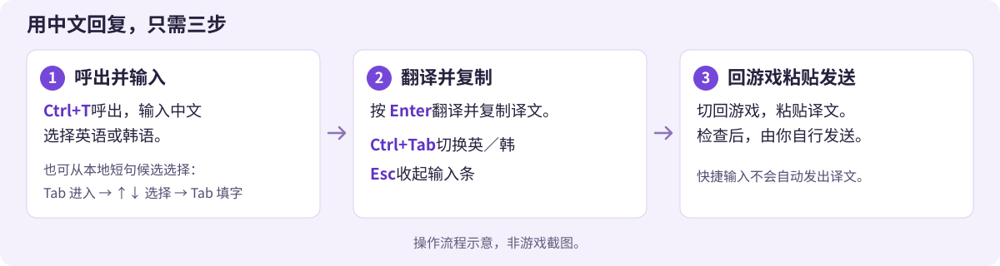
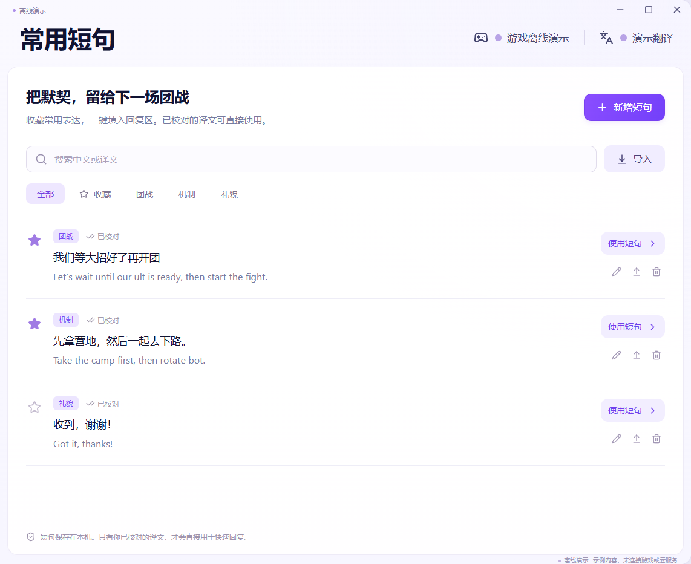
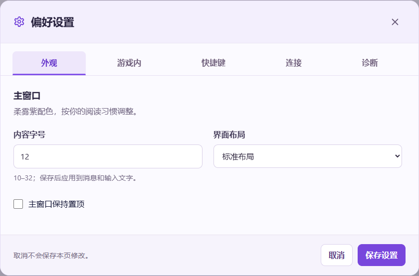
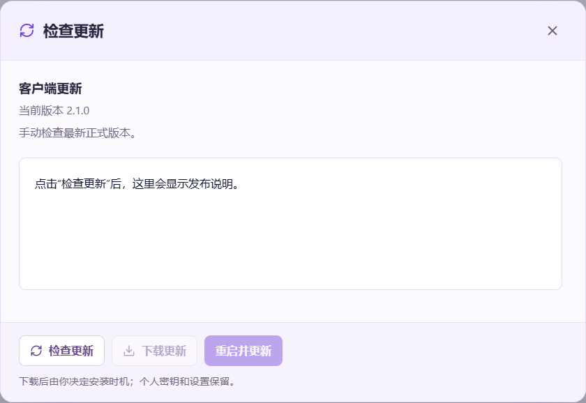
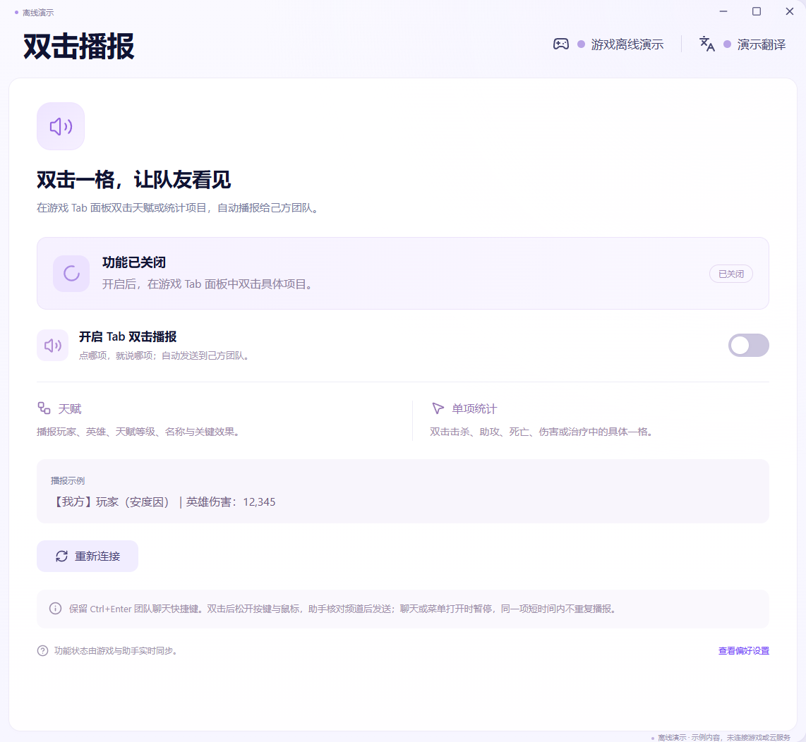
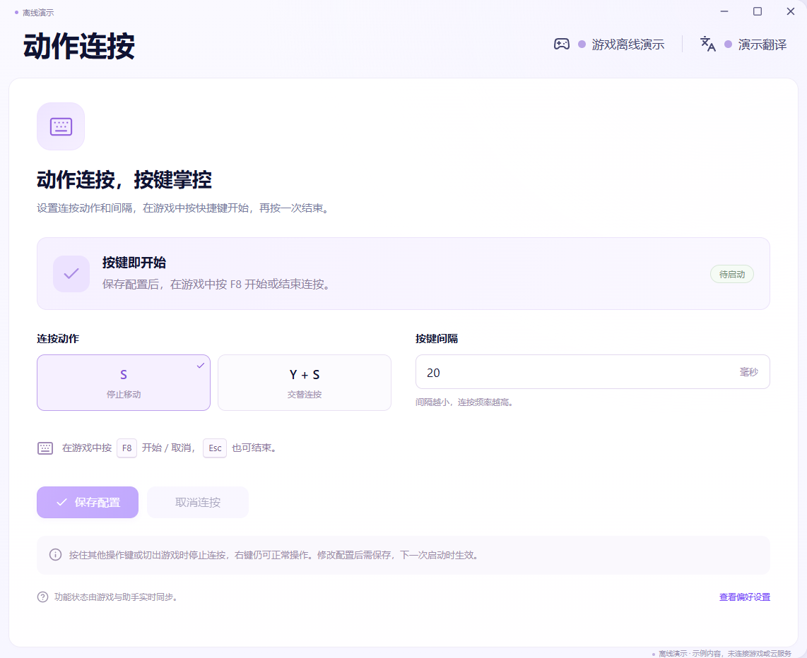

# 风暴英雄助手 · Heroes of the Storm Helper

**简体中文** | [English](README.en.md)

Windows 上的《风暴英雄》聊天翻译与游戏内辅助工具。把收到的英文、韩文聊天翻译成中文，也能把你输入的中文翻译成英文或韩文，由你粘贴发送。

**当前源码／本地正式包目标 v2.4（2.4.0）** · Windows x64 · 适配游戏 **build 98348**。公开下载仍为下方 **v2.3**；v2.4 本地构建不表示已经发布 GitHub Release。

## 下载

下方为已发布的 **v2.3 安装包**，包含升级退出交接修复、准备阶段提示和启动自动检查更新，并沿用启动保护及精灵龙修复。**从 v2.1/v2.2 升级时建议手动完整换包**，运行中的旧更新器不会自动获得退出交接修复。

**v2.4 本地构建**包含本次无时间戳对局聊天采集修复、【征召团队】已知格式支持、字幕显示器选择、增强诊断，以及完整的阿里云／DeepSeek 服务选择、API Key、余额查询和上下文设置。此前 v2.3 对局日志诊断测试包基于旧版，不包含 DeepSeek；上方公开 v2.3 包也未包含这些新增功能。

**[下载 v2.3 Windows x64 免安装包](https://github.com/renyouhao/heroes-storm-helper/releases/download/v2.3/HotsHelper-2.3.0-Windows-x64.zip)** · [发行说明与 SHA256](https://github.com/renyouhao/heroes-storm-helper/releases/tag/v2.3) · [全部版本](https://github.com/renyouhao/heroes-storm-helper/releases)

完整解压 `HotsHelper-2.3.0-Windows-x64.zip`，先退出旧助手，再启动新文件夹里的 `风暴英雄助手.exe`。ZIP 内的目录和 EXE 仍使用中文名称。保留整个目录及 `_internal`，无需安装 Python 或 SDK。发给朋友请发送完整 ZIP。GitHub 的 `Source code` 是源码，不是可直接运行的程序。

[](docs/images/v2.1/01-chat.png)

*以上及下方 PNG 均由 v2.1 当前 React 组件在隔离离线环境中生成；聊天、短句和状态为示例，不是真实游戏或云翻译结果。点击图片可查看原图。*

## 第一次使用

以下双服务选择与引导适用于 **v2.4 源码／本地构建**；上方公开的 **v2.3 下载包尚未包含**这些改动。

1. **解压并启动**：退出旧助手，双击新目录中的 `风暴英雄助手.exe`。无需另装 Python 或 SDK；若提示缺少 WebView2，请按[常见问题](#常见问题)安装微软 Runtime。
2. **先选择翻译服务**：新用户点击主界面的“选择翻译服务”，账户页先展示阿里云与 DeepSeek 两张卡片，默认均不预选；选好后才显示对应输入框。按下方[新用户与老用户步骤](#翻译服务配置与切换)连接自己的账户，也可先跳过配置，只看原文。
3. **查看游戏聊天**：启动游戏，频道先选“全部聊天”，确认“自动翻译”已开启。收到英文或韩文聊天后，在主窗口或游戏内字幕查看中文译文。建议使用无边框窗口化。
4. **用中文回复**：按 `Ctrl+T`，输入中文，选择英语或韩语，按 `Enter` 翻译并复制；回游戏粘贴、检查后自行发送。也可在主窗口“用中文回复”区输入，点“翻译中文”后“复制译文”。翻译失败会保留草稿，可修改后重试。

<details>
<summary>查看新用户选择与老用户切换流程</summary>

[](docs/images/translation-service-choice.svg)

**流程示意，非运行截图。** 图中不含真实密钥，也不表示已经连接或验证成功；实际操作请使用包含本次改动的新构建。

</details>



*上图是操作流程示意，非游戏截图。快捷输入也可用 `Ctrl+Tab` 切换英／韩，`Esc` 收起。*

完整申请步骤、使用方式和问题排查见[新手指南（HTML，下载后可离线打开）](artifacts/风暴英雄助手新手指南.html)。也可跳过云配置，先使用原文展示、开箱及连按功能。

### 翻译服务配置与切换

#### 新用户：先选择，再连接

1. 点击主界面“**选择翻译服务**”，或从“**偏好设置 → 连接 → 配置账户**”进入。尚未保存任何账户时，两张服务卡片默认都不选中；选择“阿里云机器翻译”或“DeepSeek V4.1 Flash”后，才显示该服务的凭据表单。
2. **选择阿里云**：到[阿里云机器翻译控制台](https://mt.console.aliyun.com/service)开通自己的**机器翻译通用版**，为 RAM 用户授予 `alimt:TranslateGeneral` 权限，填写同一把 AccessKey 的 **ID / Secret 两个字段**。**选择 DeepSeek**：到官方 [API Key 管理页](https://platform.deepseek.com/api_keys)创建自己的 Key，回助手填写**一个 API Key 字段**。
3. 点击“**连接并开始使用**”。验证与“你好”翻译测试成功后，助手才加密保存并启用该账户。只选择卡片或填写表单不会发送请求，也不会启用服务。
4. 暂时不想连接时，可以跳过配置，继续查看聊天原文；之后再从主界面入口完成配置。

#### 老用户：沿用或切换已有账户

1. 原有阿里云账户自动沿用，旧 DPAPI 密钥继续兼容，**不强制迁移，也无需重新输入密钥**。打开账户页时，默认选中当前实际使用的服务。
2. 想切换时，在“**要配置或使用的翻译服务**”中选择另一张卡片。选择只切换表单并清空本次凭据输入，**不发送云请求，也不立即切换服务**；“**当前服务**”始终显示实际启用的服务。
3. 对应服务已有账户时，点击“**使用已保存账户**”，验证成功后才激活，无需重输密钥；尚未保存时，按新用户步骤填写并连接。两家账户分别加密保存，可随时回切。翻译失败不会自动改用另一家服务，删除操作只针对当前使用的账户。
4. **取消未完成的配置后，云翻译保持暂停**。需要继续翻译时，回到账户页，选择原服务并点击“**使用已保存账户**”，验证成功后重新启用；已经完成的保存或删除不会因关闭页面而撤销。

#### DeepSeek 上下文设置

DeepSeek 固定使用 **`deepseek-flash`（V4.1 Flash）**，关闭思考，只返回当前一句的译文。“**发送同会话最近 3 条原文**”默认开启，可关闭；开启时最多附带同频道或同一密语联系人最近三条匿名原文帮助理解语境，不额外发送昵称，身份或联系人未知时不拼接历史。已连接 DeepSeek 后可点击“**保存上下文设置**”应用更改。主窗口和 `Ctrl+T` 的手动回复只使用本次输入，不附带游戏聊天历史。

<details>
<summary>云翻译费用与额度说明</summary>

云翻译需要联网，费用计入当前使用服务的个人账户。助手不建立本地月度用量账本、不要求填写“本月其他用量”，也没有本地 90 万字符上限。请求队列、自动翻译限流、缓存去重和暂停功能继续保留。

- **当前为阿里云**：点击“偏好设置 → 连接”或账户页中的“**查询免费额度 / 用量**”，用默认浏览器打开[阿里云机器翻译控制台](https://mt.console.aliyun.com/service)，登录自己的账号查询字符额度、实际用量与费用。助手提供控制台入口，不自动读取阿里云用量，启动时不会自动打开浏览器。
- **当前为 DeepSeek**：点击“**查询账户余额**”，助手在后台向 DeepSeek 查询，并按返回的 CNY / USD 币种显示**总余额、赠送余额、充值余额**及更新时间。查询中有状态提示；展示的是账户实际余额，不换算为“剩余字符”。费用与免费额度抵扣以 DeepSeek 账户账单为准。

本地重复结果缓存会区分服务、语言方向和上下文；相同原文的前文不同，不直接复用同一条结果。DeepSeek 请求复用固定提示前缀，服务端自动前缀缓存按实际条件尽力命中；不保证缓存命中、固定单次费用或未经测量的费用降幅。可选历史原文也计入请求输入，实际费用取决于输入、输出、上下文及缓存用量。

</details>

## 功能预览

展开图片查看对应入口；以下均为离线示例。游戏内字幕和 `Ctrl+T` 输入条仍使用原生窗口，React 主界面截图不代表它们的外观。

<details>
<summary>常用短句：整理自己的表达，收藏后可在 Ctrl+T 中选用</summary>

[](docs/images/v2.1/03-phrases.png)

新增、编辑或收藏常说的话；“使用短句”只填入回复区。`Ctrl+T` 空输入显示少量收藏，输入中文后显示匹配候选；`Tab → ↑↓ → Tab` 选择并填字，之后 `Enter` 才翻译并复制。图中的收藏和“已校对”是演示数据，正式种子短句默认未收藏、未校对；只有已校对、中文精确匹配且当前语言译文唯一时才复用本机译文。

</details>

<details>
<summary>偏好设置：调整内容字号、布局、游戏内显示及快捷键</summary>

[](docs/images/v2.1/04-preferences.png)

主窗口消息和输入字号可调，设置后点“保存设置”。“游戏内”“快捷键”“连接”“诊断”集中在同一个弹层；重复打开复用当前弹层，点击偏好设置不会呼出快捷输入。

</details>

<details>
<summary>检查更新：手动检查，确认新版后再下载和安装</summary>

[](docs/images/v2.1/05-updates.png)

图中是 v2.1 尚未检查的示例状态。v2.3 正常启动后会后台检查一次，也可点击“检查更新”手动检查；发布说明按标题、段落和列表排版。只有确认有新版时才显示提示点，下载并校验后由你决定重启安装。

</details>

<details>
<summary>Tab 双击播报：在游戏中点选天赋、统计项或我方大招冷却</summary>

[](docs/images/v2.1/06-broadcast.png)

默认关闭，需在此页主动开启。游戏 Tab 天赋页双击已选天赋或我方大招的可信正数冷却；统计页点哪一项就播报哪一项。此功能会向己方团队发送消息，详细范围与已知限制见[Tab 双击播报与更新](#tab-双击播报与更新)。本图仅展示离线入口，未连接游戏或执行发送。

</details>

<details>
<summary>动作连按：分别保存 S / Y+S 间隔，在游戏中按 F8 启停</summary>

[](docs/images/v2.1/07-repeat.png)

选择动作、填写 20–5000 毫秒间隔后点“保存配置”；保存不会自动开始。游戏前台按 `F8` 启停，`Esc`、`Enter` 或切出游戏会结束。图中“待启动”是离线示例状态。

</details>

## 功能

- **实时翻译**：支持团队、队伍、密语及所有玩家频道，新增选人／禁用英雄阶段【征召团队】的已知格式支持；大厅与显示历史分别采集，换局后自动接续，具体复验边界见下方。
- **快捷输入**：按 `Ctrl+T` 输入中文、选择英语或韩语，翻译后复制，由你回游戏粘贴发送。空输入显示少量收藏短句，输入中文后显示匹配候选；`Tab` 进入候选，方向键选择，再按 `Tab` 或点击仅填入文字，`Enter` 才翻译并复制。
- **自己的 Key 与双服务切换**：阿里云机器翻译使用 AccessKey ID / Secret，DeepSeek V4.1 Flash 使用 API Key；验证和测试翻译后分别加密保存，由你明确选择当前服务。DeepSeek 关闭思考，可选同会话最近三条匿名原文；手动回复不附游戏历史。DeepSeek 查询实际账户余额，阿里云提供控制台字符额度入口。
- **游戏内字幕**：默认底部透明字幕，可选择主屏或其他屏幕，调整位置、字号、停留时间和背景；跨屏拖动后保存，所选屏幕不可用时回退到可用屏幕。
- **柔雾紫单主题**：自 v2.0 起统一主界面、设置和游戏内浮层的柔雾紫配色，不再提供主题切换；旧主题配置自动迁移，窗口位置、字体和快捷键保留。透明字幕继续使用白字暗边。
- **常用短句**：在主界面新增、编辑、收藏自己的表达，`Ctrl+T` 中也可选择。已校对、中文精确匹配且当前语言译文唯一时，复用本机译文；缺少译文、未校对或译文冲突时仍需翻译。修改正文或译文后需重新校对。
- **开箱助手**：在助手中点击“准备开箱”，手动切到游戏补给箱页，按空格开始、暂停或继续；按 Esc 结束。
- **动作连按**：在“动作连按”页选择 S 或 Y+S，填写“按键间隔”后“保存配置”，游戏前台按 `F8` 启停。两种动作分别保存间隔，都可设 20–5000 毫秒，新配置默认 20；已有自定义值会保留。Esc、Enter 或切出游戏会结束；聊天框开着时按键会输入其中。
- **自动首选天赋**：在“天赋辅助”开启，出现待选层时触发一次游戏内的 `Ctrl+反引号`，再回读确认。复用已标爱心的方案，默认关闭，不需要翻译 Key；开箱、连按或快捷输入期间延后。
- **Tab 双击播报**：单独开启后，在游戏 Tab 天赋页双击一个已选天赋，以“注意”开头向己方团队说明玩家、英雄、真实天赋等级、名称及一句效果；任务天赋在同一格附带当前层数或完成状态，也可双击独立基础任务图标及我方大招专用标签的可信正数冷却显示。统计页双击哪一项，就只播报该项数值。默认关闭，不需要翻译 Key。
- **客户端更新**：当前源码正常启动后后台检查一次，发现新版显示提示点，也可手动检查；下载校验后，由你点击“重启并更新”。只使用官方仓库的稳定发行包。v2.3 已包含启动检查与退出交接修复，旧版建议手动换包；v2.3 与包内 2.3.0 表示同一版本，同版本不会重复升级。更新器支持 `HotsHelper-<版本>-Windows-x64.zip` 附件名。v1.0 没有内置更新按钮，1.1.0 本地包的旧更新器只识别中文名，这两种旧包均请从上方手动下载完整包。
- **图片表情**：游戏正文中的完整图片表情标签显示为 `[表情]`，纯表情不调用云翻译，英文、韩文混合消息继续翻译。
- **诊断录制与离线回放**：默认关闭，不启动诊断写入线程、不创建诊断录制文件。到“偏好设置 → 诊断”开启后，记录聊天原文、译文及翻译／自动天赋／双击播报的复现数据，再后台导出 ZIP，完成后显示可复制的文件路径。仅保留一个诊断开关，默认日志总上限 100 MiB；已配置密钥持续脱敏，用户检查聊天内容后自行分享。启动失败时另写有界的 `startup.log`，见下方常见问题。

## 版本与兼容范围

当前源码目标版本 **v2.4**，程序内版本 **2.4.0**，发行通道配置为 `stable`；本地生成正式包不会创建标签或公开 Release，公开下载附件与校验信息仍以实际 Release 为准。旧密钥、语言资料和偏好继续保留，旧主题配置迁移为柔雾紫。适配 Windows x64、游戏 **build 98348**；英文介绍不代表英文客户端的所有实机场景已验收。

**v2.4 本地构建**：团队／征召团队／所有玩家聊天兼容已验证显示历史结构中带时间戳或不带时间戳的格式，保留节点、历史链和频道校验；无需为了助手强制打开游戏聊天时间显示。无时间戳的消息时间字段留空，不编造对局时间。新增诊断区分两种格式的解析检查次数。合成读取、征召与对局切换及离线翻译链路已有覆盖；朋友机器的实际聊天格式、征召阶段采集和云翻译效果仍需新包复测，未验证的新原生记录类型不按猜测读取。字幕选屏、位置保存与拔屏恢复已通过合成屏幕及隔离窗口验证，物理双屏和混合 DPI 仍待实机验收。完整 DeepSeek 服务选择、连接、余额和上下文入口见[翻译服务配置与切换](#翻译服务配置与切换)。

**v2.2 更新**：冻结版启动前处理包内 Python.NET 与 WebView2 托管 DLL 的 Windows 下载来源标记；启动失败显示原生提示并保留异常链日志。修复合法天赋 ID 中的 `!`、`'` 被拒绝，导致精灵龙（光明之翼）及雷诺、祖尔金同类数据无法读取的问题。精灵龙使用随包 21 项真实天赋资料完成七层合成读取、单次触发与回读确认回归；原反馈电脑和游戏实机仍待复测。

**v2.3 启动检查**：正常启动后在后台检查一次官方稳定发行，发现较新版本后点亮“检查更新”旁的小点。重新连接采集不会重复检查；演示及安装自检保持离线。已确认有新版后，临时网络失败或取消任务保留小点，成功确认无需升级时清除。下载与安装仍由用户主动执行。

**v2.3 升级修复**：独立升级程序绑定桌面宿主进程，原生子进程在升级程序就绪后继续提供状态；宿主收到确认后关闭桌面壳并清理子进程，释放单实例锁，升级程序等待宿主真正退出后再替换目录。准备阶段分别显示压缩包校验、新旧文件校验、运行库复制和独立程序启动提示。旧版可能因只退出子进程而保留断连页面；实际冻结包跨版本升级仍待实机验收。

**v2.1 更新**：统一 React 偏好设置、账户、更新和短句编辑弹层；主窗口字号与置顶实际生效，状态和更新提示点对应真实结果，发布说明按 Markdown 结构排版；原生 `Ctrl+T` 增加本地短句候选，完善有效译文复制与失败后草稿恢复；同一 R 天赋图标与 CD 覆盖层归并，避免冲突命中。

**v2.0 基础**：React + WebView2 桌面主界面、柔雾紫单主题与紫色六角旋涡图标；保留 B 方案悬浮窗布局和操作，统一 100 MiB 诊断录制与离线回放，并补齐当前 build 的全部模型解码分支。

build 98348 的模型解码已覆盖 **0–15 全部 16 个分支**，每个分支核对计算代码指纹；2、5、8、11、14 另读取动态 salt，读取后复核模式、表根、编码槽、使用的 key 与 salt 指针和值。16 个算法已完成合成读取及独立原生指令对照；这不表示朋友机器逐个实测过全部 16 分支，也不自动支持其他 build。

<details>
<summary>历史版本与旧包升级说明</summary>

历史功能沿用：v1.2 曾新增轻量诊断、图片表情处理、S/Y+S 分别配置间隔、自动首选天赋、Tab 天赋／统计单项双击播报和客户端更新；修复播报卡顿、输入后偶发未提交、对局聊天来源与换局探测，并移除本地用量账本、增加阿里云控制台入口。公开 v1.2 同时统一 GitHub ASCII 附件名与更新器识别规则，并使用《风暴英雄》图标；v2.0 将 EXE、任务栏及窗口标题统一为紫色六角旋涡标志。自动天赋和双击播报默认关闭，诊断每次启动默认关闭。各功能的实测范围见下文与 Release 说明。

版本注记：`v1.1` 只保留为源码准备标签，没有公开发布 Release。发布准备时发现 GitHub 会截去中文附件名中的中文部分，因此保留原标签，修复发布资产命名约定后改发 `v1.2`。**此前的 1.1.0 本地包只识别中文 ZIP 名，请手动下载上方 v2.3 完整包**；旧用户数据无需搬动。

</details>

## 界面与常用入口

**v2.1 构建采用以下桌面主界面。** 下载时保留整个 Windows ZIP 内容；旧发行包不会因更新源码而改变界面。

主界面使用 **React + TypeScript + CSS**，由 **pywebview + Microsoft Edge WebView2** 显示本地打包资源，不需要浏览器标签页或开发服务器。六个主页面，以及偏好设置、检查更新、个人密钥和短句编辑，统一在 React 界面内显示；管理操作共用一个页内弹层，重复点击复用当前界面，不再叠开原生设置窗口。Python 继续处理采集、翻译、持久化和游戏输入；游戏内字幕与 `Ctrl+T` 输入条保留原生 Tk，`-Legacy` 兼容入口仍使用原 Tk 界面。以下新增交互只在包含这些改动的构建中生效。

主界面按选定的浅紫原型重排：柔雾紫侧栏、白色内容卡片和紫色主按钮。左侧图标导航切换实时消息、常用短句、开箱助手、动作连按、天赋辅助和双击播报，底部提供“偏好设置”和“检查更新”。界面只保留柔雾紫主题，旧配色配置启动时自动归一，无需手动切换。EXE、任务栏及窗口标题均使用同一个紫色六角旋涡标志。

“偏好设置 → 外观”的内容字号实际作用于 React 消息和输入文字，“主窗口保持置顶”作用于可见的 WebView 窗口，也可选择标准或精简布局。主窗口透明度与位置锁定目前只在 `-Legacy` 兼容界面提供，原有设置行为保留。打开偏好设置不会打开快捷输入；禁用呼出快捷键后，可从“快捷输入”按钮进入。

**把字幕移到主屏**：打开“偏好设置 → 游戏内”，在“字幕显示器”中选“主显示器”，点击“移动到所选屏幕”，字幕会移到该屏底部并保存。也可选择其他显示器；“保存并调整位置”“保存并放到底部”同样采用所选屏幕。同屏调整保留已有自定义位置，底部预设按该屏工作区估算位置，不检测游戏 HUD。进入调整态后可拖到另一屏，松开鼠标即保存位置与屏幕，完成后点“完成调整”。所选屏幕拔出或布局变化时，字幕回退到最近的可用工作区，可重新选屏。此选择用于聊天字幕，`Ctrl+T` 输入条仍独立定位。

**征召聊天与频道筛选**：【征召团队】指选人／禁用英雄阶段的己方聊天。“全部聊天”“团队与所有玩家”“仅团队”均包含普通【团队】与【征召团队】；“仅征召团队”只显示和接收征召聊天。【队伍】与【密语】各自独立，不归入“仅团队”。实时消息列表按所选频道显示，筛选也控制后续接收；切回其他筛选不会补收被过滤期间的消息，也不删除已有消息。

实时消息以昵称、频道、时间、正文和译文分层显示，圆形头像使用本地装饰图案，未识别真实英雄头像。下方“用中文回复”和“译文预览”并排，预览区的英语／韩语胶囊选项用于切换目标语言；翻译后点击“复制译文”，再自行回游戏粘贴发送。`Ctrl+T` 快捷输入仍可单独使用。

主窗口手动翻译失败时，错误留在回复区，保留输入供修改或重试；“复制译文”依据后台当前有效译文。辅助页分别显示等待、运行和停止状态，并保留最近一次结果。更新说明按标题、段落和列表排版，随内容区宽度换行；当前源码正常启动时后台检查一次，侧栏提示点只反映已确认的新版本，待安装时继续保留。已发布的 v2.2 安装包仍只在手动检查后访问发行服务。

小窗口会自动压缩留白和辅助说明，调整导航与操作区的排列，保留中文输入、译文和语言选择。游戏内字幕与快捷输入条继续独立显示。

新桌面主界面需要 [Microsoft Edge WebView2 Runtime](https://developer.microsoft.com/microsoft-edge/webview2/)。若启动提示缺少 Runtime，请从微软官方入口安装后重试；不会静默换成旧浏览器渲染。完整构建产物运行无需安装 Node.js。源码可加 `-Legacy` 使用原 Tk 主界面作兼容入口。引入 WebView2 后需要重新测量整个进程树的内存和 CPU；旧 Tk 性能记录不能代表新界面，不承诺占用低于 100 MiB。

### 悬浮窗已采用 B 方案，保留 A/B 本地预览

**本轮沿用 B · 原样换配色**：柔雾紫浮层与主界面使用同主题颜色，保留原有字幕窗布局、单行输入、语言下拉及基础快捷键；透明字幕仍为白字暗边。快捷中文输入标题左侧使用主界面的紫色六角旋涡标志，并保留 Enter 翻译并复制、Esc 收起、Ctrl+Tab 切换语言。输入条增加少量本地短句候选：Tab 先进入候选列表，方向键仅在候选内选择，再按 Tab 或用鼠标填入中文，之后 Enter 翻译并复制；输入法选字时不接管候选快捷键。候选仅来自自己的短句资料，未校对的条目不承诺离线翻译。发行构建会核验 WebView2 页面加载与离线桥接；真实游戏中的显示、焦点、输入及不同 DPI 体验仍按实机结果验收。

也可双击项目根目录的 `打开悬浮窗对比.cmd`，无需 PowerShell，默认打开 B 方案的快捷输入预览，命令行窗口不会常驻。运行 `预览悬浮窗AB.ps1` 也可打开对比控制台，切换“A · 原型新样式”／“B · 原样换配色”和“默认字幕”／“消息面板”／“快捷输入”；“切换浅色背景”“下一条消息”“恢复位置”用于比较显示效果。**A** 的双栏输入、圆角和浅紫白面板保留为备选预览；在预览里切换方案不会改写正式配置。

```powershell
.\预览悬浮窗AB.ps1
.\预览悬浮窗AB.ps1 -方案 B -状态 input
```

`-方案` 可选 `A`、`B`，`-状态` 可选 `subtitle`、`panel`、`input`，默认 `B`／`input`。预览使用项目现有虚拟环境和 Tk，无需 npm、构建或网络；不读取游戏、密钥或偏好，不调用云服务，不注册全局 `Ctrl+T`，该快捷键只在预览窗口内使用。在演示短句下拉框中选择后点“填入输入条”，可查看离线英韩译文，其他输入会提示选择演示短句；点击复制或执行“翻译并复制”会改写剪贴板。预览用于比较外观与操作，实际游戏中的显示、焦点和输入体验仍需另行验收。

## Tab 双击播报与更新

在“双击播报”页的“发给队友的播报语言”选择 **中文 / English**，选择后保存，重启沿用；默认中文。英文模式使用随包离线资料输出英雄、天赋、基础任务、大招名称与统计文案，例如 `[Ally] Player (Anduin) | Hero damage: 12,345`；英文昵称保留，中文及其他非拉丁文字昵称以 `Player N`（可信槽位序号）代称，并保留英文英雄名；不猜译人名，也不增加云翻译用量。切换会取消尚未发送的旧动作，下一次双击使用新语言。英文资料缺项时拒绝该条，不混发中文或内部 ID；此选项与聊天翻译目标独立，也不表示英文游戏客户端已经实机验证。

在助手的“**双击播报**”页勾选开关，再回游戏打开 Tab 的**天赋页**。双击一个**已选择**的天赋，助手会向**己方团队**发送，例如：`注意【敌方】玩家（克罗米）｜5级天赋「莫比乌斯回路」：……`。层级读取英雄的真实目录，克罗米等特殊英雄不会套用常规等级。中文短效果随包离线提供，不现场调用 AI，也不增加翻译用量。

**任务与层数**：我方、对方的任务天赋都在原来的同一个天赋格双击；可信计数会附加 `任务层数：0` 等内容，有限任务完成时说明“任务已完成”。Tab 中独立显示的基础任务图标也可双击，例如阿尔萨斯的“霜之哀伤的饥渴”。离线中文名称目录当前收录 16 个有明确 Face 与本地化来源的基础任务条目；精确名称未命中时，仅在原生任务身份和数值仍通过校验后使用“基础任务1／基础任务2”，不会猜成某个技能。逻辑面向公共 UI 结构，不保存本机对象地址；这不表示全部英雄或所有增益叠层都已实测。进行中的真实 `0` 层可以播报；隐藏、未跟踪或无法确认的计数不按零处理，也不使用隐藏标签遗留的旧数字。

**我方大招冷却显示**：在同一 Tab 天赋页双击自己或队友的大招图标，仅播报专用冷却标签当前可见且通过绑定校验的正数秒数，例如 `冷却显示：38秒`。敌方大招不读取、不播报。游戏从两个时间通道选择这个显示，它可能是充能恢复计时；该读数不代表大招当前不可用、充能已经耗尽，也不承诺这些秒数之后就能释放。充能次数、重置与技能变体还可能影响可用性。标签隐藏、空白或显示零都不据此推断“已就绪”，也不猜剩余充能次数；猎空的专用充能 UI 尚未验证，暂不支持。未选大招、绑定变化或状态未知时不发送。

同一大招的天赋图标与冷却层重合时，按已验证的玩家、技能及原生位置归并为一个冷却目标，避免把同一图标误判成两个冲突目标。有可信正数时播报冷却；没有可信读数时不生成冷却消息，普通天赋仍按原规则处理。其他真正重叠的不同目标继续拒绝播报。

此前真实只读对照包含凯尔萨斯热能对流 `0 → 2` 层、敌方阿尔萨斯基础任务 `6 → 8` 层，以及我方大招 `38／29` 秒的显示；另在萨拉塔斯试用中采到 `42／9` 秒，并确认原先普通天赋与冷却目标重叠导致点击被拒绝。v2.1 修复后，仅确认萨拉塔斯试用中 45 秒对应同一 R 的唯一冷却命中；最终聊天发送仍待用户反馈。这些记录证明对应现场样本的读取或命中结果，不代表全部英雄、客户端语言或分辨率均完成实机发送验收。版本、原生布局、图标身份或状态不匹配时返回未知；0–15 模型解码用于定位玩家模型，后续任务／冷却读取还有各自的绑定与显示校验。

统计页**点哪一项，只发哪一项**。支持击杀、助攻、死亡、英雄伤害、攻城伤害、治疗、自我治疗和经验贡献；例如只双击英雄伤害：`【我方】玩家（安度因）｜英雄伤害：12,345`，不会带上死亡或其他数据，不加个人排名、表现评价。数值使用发送准备时最后一次可信读取的快照，持续变化不会把同一格当成别的目标。显示 `0` 可以播报，显示 `—` 不播报。玩家与格子归属、面板可见性或数据无法确认时不发送。

开关默认关闭，偏好可保存；演示模式不监听双击。双击后松开鼠标和按键，保持游戏前台。游戏的 **Ctrl＋Enter 团队聊天快捷键**须保持默认；聊天框、菜单、开箱、F8 连按、快捷输入或升级准备期间暂停。发送前核对团队空框，输入后逐字回读，再提交；不改剪贴板，不覆盖用户草稿。失败不自动重试，可能留下未提交文字，可按 Esc 取消。同一项 3 秒内不重复尝试，任意两项间隔至少 2 秒，关开开关不能绕过限频。

兼容带 Windows 注入标记的桌面点击，助手自身标记的输入仍被忽略。未识别到格子、操作取消和限频原因会显示在助手的“双击播报”页。主窗口底部的大厅／对局文字表示聊天采集来源，不代表双击播报的开关或当前识别结果。即使 Tab 没关就退出对局，旧对局的待发动作也会失效；新局需要重新打开面板并双击，不沿用上一局目标。

本轮将动作连按的会话状态与发送互斥分开：空闲监听不再因播报持有输出锁而阻塞键盘或计时回调；F8、Esc 仍及时处理，连按输出等待当前发送结束，取消仍等待已有输入结束。正文沿用批量 Unicode 输入，不改剪贴板；并非逐字设置延时。

输入框状态短暂变化时，只在已确认的同一对局内做有界只读重采样，每个确认阶段以 400 毫秒为期限；稳定时立即继续。正文与提交按键不会因重采样重复执行。换局、菜单打开、切出或新的按键／鼠标操作仍会停止本次发送。若文字留在框里，先看“双击播报”页的具体原因；聊天框仍打开时，先按 Esc 关闭，再双击。若提示“消息可能已经发送”，请先查聊天记录，避免重复。切回助手查看时，普通点击不会覆盖上次结果。需要排查时可开启“设置 → 诊断”，复现后导出；会记录失败阶段、错误码、耗时及回放需要的输入、状态和内容。

此功能只在点击或已有待发动作时读取面板，右键移动与空闲不触发整板读取；鼠标事件保持透传。当前针对中文 build 98348 做试用只读对照；用户已在前一修复包确认天赋与统计双击能发到团队；本轮提速后的完整实机耗时、乱斗连续多局、英文客户端、其他分辨率仍需要验收。未知版本不发送。

更新时点击主窗“**检查更新**”，确认新版本说明后点“下载更新”，完成后点“重启并更新”。v2.3 正常启动会在后台检查一次；旧版建议通过上方下载入口手动换包。只读取 `renyouhao/heroes-storm-helper` 官方稳定 Release，不降级。缺少可信 SHA256 或完整发行包时不给自动安装入口。完整包校验后，v2.3 的独立升级程序等待整个桌面宿主退出，备份并替换程序目录，再启动新版本；失败尝试恢复旧程序，保留本机密钥、语言资料与偏好。准备时会显示当前校验或复制阶段。请放在可写的普通目录，保留整个程序文件夹。

从源码运行时可以检查和下载，界面显示可复制的 ZIP 路径；源码目录不会被替换。关闭助手或重新检查会回收未交给升级程序的暂存包。更新核心已用临时目录测试替换、回滚和异常分支；真实冻结版跨版本替换仍待验收，新版启动检查仅确认短期存活。

**旧版停在“正在准备独立升级程序…”且显示连接中断**：已确认旧流程只退出原生子进程、桌面壳仍占用目录和单实例锁的设计缺口；仅凭等待时长不能确定现场是否触发同一原因。先关闭整个旧助手，再将包含修复的新发行包完整解压到新目录，运行其中的 `风暴英雄助手.exe`，保留 `_internal`。本机密钥、短句和设置继续使用原用户目录；旧更新器本身不能通过下载新源码获得修复。公开 v2.3 包已包含此修复，请从上方下载完整 ZIP。

## 本机数据与隐私

用户数据由助手自动创建在 `%LOCALAPPDATA%\HotsChatHelper`，不需要手动建文件或从别人电脑复制。

- 两家服务的密钥分别保存为当前 Windows 用户绑定的 DPAPI 加密配置，不能当作可共享配置分发；已有阿里云 DPAPI 凭据继续兼容。全局界面状态快照只含服务、配置状态、遮罩 Key、余额和安全反馈，不含完整 AccessKey ID / Secret 或 DeepSeek API Key。
- 凭据、语言资料（含常用短句）、偏好与诊断日志继续使用上述用户目录；密钥、用户数据库和真实聊天采样不提交到本仓库。
- 旧版本的 `usage.sqlite3` 与 `usage.sqlite3.initialized` 保留原样，当前版本不读取、不新建，也不迁移或修复；旧账本缺失或损坏不影响启动、云配置或翻译。助手不再建立本地月度账本。
- 正式启动不自动读取项目 `.env`，不使用共享密钥，也不会自动导入 `txt/` 等本地测试文件里的 Key，或将这些文件打包、自动上传。阿里云账户表单的“导入本机旧 .env”只读取你主动选择的文件，上限 16 KiB；仅把两个密钥字段填入本次输入框，不自动连接。切换服务、提交或关闭时清空本次凭据输入，已存密钥不会回填。
- 云翻译将当前待译正文发送给你明确选择的阿里云或 DeepSeek。DeepSeek 上下文选项开启时，另附同会话最多三条匿名历史原文，不附发言者昵称；关闭时不附历史。手动回复只发送本次输入。助手不会因失败自动切换到另一家服务。
- 界面聊天历史保留本次运行最近 500 条，退出后清空。诊断默认关闭，需用户主动开启；开启后即包含聊天原文、译文及可重放边界数据，没有额外的“详细诊断”开关或十分钟到期。
- 日志在本机 `logs` 子目录后台保存，默认总上限 100 MiB（104857600 字节），滚动覆盖最旧文件、保留期 7 天。过载允许丢弃诊断并计数，不等待磁盘；覆盖、超限、截断和写入失败会在摘要中标明。100 MiB 是日志文件总上限，导出 ZIP 大小取决于压缩率。
- 已配置的 Key/Secret 在普通字段和嵌套复现数据中脱敏；聊天中的其他私人信息仍需分享前检查。导出只含日志及摘要，不含凭据文件、数据库或偏好，不自动上传，也不调用云服务。脱敏或截断可能影响重放，报告会标为不完整。

## 从源码运行

需要 Windows x64、Python **3.10 或以上**（发行包使用 Python 3.12 构建）、Node.js LTS（含 npm）与 WebView2 Runtime。Node.js 仅供源码安装和前端构建使用。在项目根目录用 PowerShell 执行：

```powershell
.\安装依赖.ps1
.\启动助手.ps1 -Demo  # 离线演示，不读取游戏、真实凭据或调用云服务
.\启动助手.ps1        # 正式运行，使用自己的 Key
.\启动助手.ps1 -Legacy -Demo # 原 Tk 主界面离线兼容入口
```

也可手动建立虚拟环境：

```powershell
py -3 -m venv .venv
.\.venv\Scripts\python.exe -m pip install -r requirements.txt
.\.venv\Scripts\python.exe -m pip install --no-deps -e .
Push-Location frontend
npm.cmd ci
npm.cmd run build
Pop-Location
.\.venv\Scripts\python.exe -m hots_chat.app --demo
```

Python 发行包名为 `hots-assistant`；源码模块和本机数据目录沿用 `hots_chat`、`HotsChatHelper`。

`安装依赖.ps1` 会验证 Node.js/npm、安装 Python 和前端依赖，并构建 `frontend/dist`。启动脚本直接加载该目录，不会启动 Vite 服务；缺少资源时先重新运行安装脚本。直接执行模块时，`--legacy-ui` 对应脚本的 `-Legacy`。

## 测试

以下测试使用合成数据、受控离线云服务和临时用户目录。Windows 下的界面集成测试会创建自有隐藏 Tk 窗口，不操作用户正在使用的游戏或助手界面。

显示历史采集现在只用团队／征召团队／所有玩家消息校准来源，避免误接大厅／密语记录。旧聊天仍持续更新时也会按有界计划探测其他来源，避免一直停留在旧局；大厅队伍与密语继续由独立来源接收。朋友现场的漏采是否属于同一原因仍需复现确认，v1.0 没有诊断导出；本轮版本可在进局前开启“设置 → 诊断”，复现后导出 ZIP 并附发生时间。

v2.3 通过 **179 项相关 Python 回归、33 项前端测试**及前端构建，覆盖升级事务、宿主 PID 传递、原生状态保活、宿主幂等关闭及关闭时 IPC 锁顺序。本次 **2.3.0 正式冻结包**已通过安装、桌面依赖和实际 WebView2 渲染／桥接自检，99 个冻结业务模块与 `v2.3` 标签源码核对一致。公开附件已通过更新器检测、下载、SHA256 校验和隔离解包；2.2.0 能发现新版，2.3.0 不会重复升级。真实冻结包跨版本原地替换仍待验收。下载和校验信息见 [v2.3 Release](https://github.com/renyouhao/heroes-storm-helper/releases/tag/v2.3)。

v2.2 发布源码 `38df948` 通过 **375 项 Python 测试（24 个模块各自独立进程）、33 项前端测试**，并完成 Python 语法及依赖检查。完整冻结包的安装、桌面依赖、WebView2 实际加载与桥接自检全部通过；给三个托管 DLL 添加下载标记后，程序自动清除标记并再次通过渲染自检。真实发布资产已通过 2.1 更新器的检测、下载、SHA256 校验和隔离解包；未执行原地安装，未在原反馈电脑或真实游戏中验收。下载与校验信息见 [v2.2 Release](https://github.com/renyouhao/heroes-storm-helper/releases/tag/v2.2)。

本地用量移除的回归重点：空白用户目录启动不创建账本或标记；已有损坏账本不阻断配置、翻译及凭据重载，旧文件内容保持不变；身份验证与“你好”测试成功后才加密保存并启用。请求队列、自动翻译限流、缓存去重和暂停仍需通过原有回归。历史 v2.1 最终回归通过 **570 项 Python 测试、33 项前端测试**；验证范围、构建提交、包校验与 SHA256 以 [v2.1 Release 记录](https://github.com/renyouhao/heroes-storm-helper/releases/tag/v2.1)为准。此前统一源码 `51daf8e`（并入 `69ec5a3`）完成 1247 项测试（113 个模块各用独立进程）、20 项采集探针及对应 1.1.0 冻结包安装自检；这些数字属于原验证基线，不代表 v1.2 的新一轮测试结果。v1.2 的测试总数、正式包提交、SHA256 与验证记录以 [Release](https://github.com/renyouhao/heroes-storm-helper/releases/tag/v1.2) 为准。以下旧版数字与真实云调用记录保留其原版本范围。

```powershell
Get-ChildItem tests/test_*.py | ForEach-Object {
    .\.venv\Scripts\python.exe -m unittest ("tests." + $_.BaseName) -q
    if ($LASTEXITCODE -ne 0) { throw "测试失败：$($_.Name)" }
}
.\.venv\Scripts\python.exe -m unittest discover -s probes -p "test_*.py" -v
.\.venv\Scripts\python.exe -m compileall -q src tests tools probes packaging
.\.venv\Scripts\python.exe -m pip check
```

0.3.12 发布前完成 **855 项完整测试、20 项采集探针**及发行自检；包内代码与源码核对通过。发行 EXE 另在临时空白数据目录完成真实云配置、加密保存、重新加载和再次翻译测试，合计 2 次翻译、4 字符。该结果是本机验证，不代表所有玩家电脑上的网络、权限和游戏更新情况。

0.3.13 此前完成 **917 项完整测试、20 项采集探针**、安装自检与 65 个包内运行模块的源码一致性核对。诊断的五轮合成性能比较达到预设目标，默认关闭不创建日志线程或文件；开启后的实际开销仍取决于负载和电脑。

0.3.14 完成 **923 项完整测试、20 项采集探针**及发行安装自检，65 个包内运行模块与源码一致、1658 个 ZIP 文件与清单一致。新增覆盖 S 自定义间隔、两种动作默认 20 毫秒、分别保存及旧配置保留。本轮未调用真实云接口，也未向真实游戏发送按键；实际动作效果与系统调度抖动仍需玩家手动验收。

## 构建 Windows 发行包

在 Windows 的项目根目录执行：

```powershell
.\.venv\Scripts\python.exe -m pip install -r requirements-build.txt
.\.venv\Scripts\python.exe -m tools.build_release --output "releases/v2.4"
```

构建先运行 `npm ci` 和 `npm run build`，确认前端产物完整，再由 PyInstaller 冻结 Python。包内包含 `frontend/dist`、WebView2 桥接及 pythonnet 动态库，不打包 Node.js、开发服务器或其他 Qt/CEF 浏览器后端；WebView2 Runtime 由目标电脑安装。

此命令的正式包输出为 `releases/v2.4/HotsHelper-2.4.0-Windows-x64.zip`，ZIP 内仍是中文目录和 `风暴英雄助手.exe`。内部版本为 `2.4.0`，发行通道为 `stable`；单独运行构建命令不会创建 Git 标签或公开 Release，当前文档不提供尚未发布的 v2.4 下载链接。构建流程仅打包程序、本地前端资源与公开种子数据，并附带使用说明和新手指南；会拒绝将 `.env`、加密凭据、用户数据库、运行日志及采样记录混入发行包。

打包依次执行 `--check-installation` 检查原生业务和种子数据、`--check-desktop-installation` 检查桌面资源与依赖、`--check-desktop-rendering` 实际加载本地 WebView2 页面并核验 React 离线演示与网页桥接；三项均通过后才继续生成 ZIP。`发行校验.json` 分别记录结果。包内“查看界面效果.cmd”可直接启动离线演示。自检确认加载与桥接，视觉还原、跨 DPI 显示和游戏中表现仍需独立验收。

新包通过安装自检、ZIP 逐文件大小与 SHA256 校验，并成功写出 `发行校验.json` 后，才自动清理旧包。默认 `releases/` 及其发行子目录只保留本次 ZIP、校验文件与对应构建目录；仅删除可识别的历史发行包和构建临时目录，无关文件与源码目录保留。构建或校验失败时不清理旧包；自定义外部 `--output` 只清理该输出目录内明确的构建产物，不清理父目录，含符号链接或目录联接的目录跳过。

## 常见问题

**账号已验证，翻译仍失败**：身份验证只说明 Key 能识别账号，还需开通机器翻译通用版、授予翻译权限并保证账号服务可用。0.3.12 会显示失败阶段及安全错误类别；检查提示后再重试。

**新界面无法启动或提示缺少 WebView2**：先安装微软官方 WebView2 Runtime，再重启助手。源码运行还需先执行 `安装依赖.ps1` 生成前端资源；可用 `启动助手.ps1 -Legacy` 临时进入旧主界面，个人数据沿用原目录。

**下载解压后双击没有界面**：Windows 可能将 ZIP 的下载来源标记传播给 `_internal` 中的 DLL，使 Python.NET 或 WebView2 程序集无法加载。v2.2 冻结版在导入应用前，仅处理包内 `Python.Runtime.dll` 和两个 WebView2 托管 DLL 的来源标记，保留 DLL 内容；源码运行不执行此操作。若文件权限使处理失败，会弹窗提示，不再只向隐藏控制台输出错误。

确认压缩包来自官方发行后，可右键原 ZIP → 属性 → 勾选“解除锁定” → 再完整解压。已经解压时需对整个应用目录解除锁定，单独解锁 EXE 不够；也可在 PowerShell 执行下列命令，将路径改成自己的完整解压目录：

```powershell
Get-ChildItem -LiteralPath 'D:\你的解压目录\风暴英雄助手' -Recurse -File | Unblock-File
```

**启动失败日志在哪里**：v2.2 启动保护在失败时写入 `%LOCALAPPDATA%\HotsChatHelper\startup.log`，保留最近一次异常链，文件上限 128 KiB；正常启动不创建该文件。日志写入失败时仍尝试显示原生错误提示。此日志独立于“诊断录制”开关，不主动读取凭据、环境快照或栈帧局部变量；分享前检查异常正文与路径。

**没有中文译文**：确认自己的 Key 已连接、“自动翻译”已开启且频道筛选正确。当前接收翻译只支持英文和韩文，其他语言仅保留原文。

**返回大厅或换局后没消息**：先在游戏内发送一条普通聊天；仍不恢复可在“设置 → 连接”手动重新连接。独立战网客户端的聊天不在采集范围内。

**大厅能收到，对局显示“等待对局聊天，自动恢复”**：大厅与对局使用独立的采集来源；该状态表示对局聊天记录尚未接入，不能据此判断没有识别到游戏进程。请在正在进行的一局中切到【团队】，发送 `hello`，先确认游戏聊天框确实显示该文字，再检查助手是否收到原文。原文也没有时先排查采集；原文有而没有译文时再检查自动翻译、语言与服务配置。当前支持已验证显示历史结构中的简体中文频道标记“团队／征召团队／所有玩家”；其他客户端语言与未验证记录结构需要单独验证。

本次源码修复了同一轮扫描中先检查到仅大厅频道的聊天记录、之后记录新增团队消息仍被跳过的问题；发现器会重新检查变化的消息快照，缓存仍有数量上限。该修复不保证所有“等待聊天”情况都已解决；新消息如果位于已扫描区域且后面没有同源候选，仍需后续扫描。需要运行包含修复的新构建，旧 EXE 不会随源码更新而改变。

**游戏聊天不显示时间时漏采**：旧采集入口强制搜索时间戳标记，会漏掉不带该标记的聊天。v2.4 对已验证的简体中文团队／征召团队／所有玩家显示历史结构增加无时间戳入口，游戏时间显示开关可由玩家选择；没有原生时间的消息保留空时间，不用本机时间冒充。当前合成测试证明两种结构及切换可处理，不表示朋友机器已经实机通过；仍需用包含修复的新包复测。复验征召聊天时，在选人／禁用阶段切到【征召团队】，发送测试文字并记下时间与所处阶段，确认游戏中可见后再导出诊断包。

新构建在开启诊断后，对局采集摘要用 `capture_schema=2` 标识兼容有／无时间戳的日志能力；合并与队列等其他阶段可保留各自的 schema。`capture.state` 的 `source=match`、`stage=initial/discovery/inventory` 分别记录首次定位、恢复定位和后台盘点，每轮有独立 `scan_id`，区分开始、进度、候选命中、耗尽、超时、失败和取消；进度最多每 5 秒记录一次，终态立即记录。`candidate_found` 只表示发现候选，读取器接入另记 `reader_id`。接入后即使没有消息，也有受限的轮询摘要；中途开启诊断时，会在后续摘要中看到当前状态，不补造之前的过程。

扫描摘要包含请求／实际读取字节、短读、候选结构拒绝及时间格式、未知频道、来源频道过滤、消息格式等检查计数，固定原因码不会夹带被拒绝消息的正文或昵称。`timestamped_message_count`／`untimestamped_message_count` 分别统计完整解析成功的带／不带时间戳检查；它们与其他检查计数都可能含重复轮询，不能当成交付消息数；实际交付看 `message_count` 与 `publish`。扫描的 `read_calls/read_bytes` 只计扫描块，轮询阶段则计该读取器累计读取；各自以 `scan_id/reader_id` 区分边界。消息使用子来源 `message_id`、合并后的 `message_id` 与 `source_message_id` 对应，再连接队列及现有翻译日志。同步交接可能使日志落行顺序与业务阶段顺序不同，应按 ID 关联。没有前缀候选只能说明扫描范围尚未命中，不能直接推断游戏无发言或某项游戏设置错误。

让朋友采集一份可分析的日志：

1. 使用包含这些日志的新构建，进局前在“偏好设置 → 诊断”开启日志。
2. 保持原来的客户端语言和对局模式，在实际对局的【团队】发送 `HOTS_CAPTURE_TEST hello`，确认它确实出现在游戏聊天框，记下本地时间。
3. 让助手继续运行至少 90 秒；仍卡住时可只点一次“重新连接”，再保留约 30 秒恢复记录。这些时间用于覆盖日志阶段，不承诺在此时间内接入。
4. 关闭助手前导出诊断 ZIP，同时说明客户端语言、模式、标记时间，以及助手有没有显示原文。开启的统一日志包含原文／译文，分享前检查内容；不需要另附凭据。

项目开发规则见根目录 `AGENTS.md` 和 [hots-diagnostics skill](.agents/skills/hots-diagnostics/SKILL.md)：后续新增功能、修改行为或修复缺陷，需要同时交付可关联的日志和真实 ZIP 导出验证；纯文档／不影响行为的展示素材无需伪造业务日志，改变运行行为的配置或数据仍需验证。这是开发与审查要求，不能代替实机验收。

**大厅昵称显示未知**：助手会尝试从已验证的同账号记录恢复昵称；无法确认身份时保留未知，不猜测其他玩家的名字。旧未知消息不自动补名。

**F8 没有效果**：确认游戏在前台、单独按 F8 并松开组合键；查看底部状态提示。可在“设置 → 快捷键”修改为 F1–F12。

**连按间隔怎么设置**：在“动作连按”选择 S 或 Y+S，填写“按键间隔”后点“保存配置”，再回游戏按 F8。两种动作都能编辑，范围 20–5000 毫秒，分别保存，新配置均默认 20；旧版本保存过的 Y+S 间隔继续使用。S 填 100 表示每隔 100 毫秒按一次 S；Y+S 填 200 表示 Y → 等 200 毫秒 → S → 等 200 毫秒再循环。保存配置会结束当前动作，不会立即自动开始；实际节奏受 Windows 和游戏响应影响，卡顿不补发。

**如何反馈链路问题**：先到“设置 → 诊断”勾选“开启诊断日志”，复现问题后导出 ZIP，说明大致时间与操作。开启后包含聊天原文、译文及复现数据，分享前检查聊天隐私。关闭后不再记录新事件，已有日志仍可导出；下次启动仍默认关闭。已配置完整密钥脱敏，不要另行附带 `.env` 或 `credentials.dpapi`。

**自动天赋和双击播报都无效时如何复现**：使用包含本次诊断录制的新构建，保留原来的客户端语言、分辨率和缩放设置。在进局前开启诊断，再启用“天赋辅助”和“双击播报”。进入正常对局，记录自动天赋未生效的大致时间；打开 Tab，分别双击一个已选天赋和一个统计数字，记下时间及“双击播报”页提示，随即导出 ZIP。请同时说明游戏 build、对局模式、窗口模式、Windows 缩放比例及显示器数量。若翻译异常，在日志开启期间复现收到消息或手动翻译；旧 EXE 不会因更新源码而自动增加这些记录。

`helper.read`（读取）和 `helper.click`（鼠标命中）事件使用 `source=talent/broadcast` 区分自动天赋与双击播报；同一运行的时间与会话编号可用于交叉比较。双击的 `attempt_id` 关联每次左键按下及其后续复核，不是双击手势编号。除聊天和回放内容外，以下有界字段用于快速定位，不保存原始内存地址或进程路径：

| 诊断内容 | 关键字段与解释 |
| --- | --- |
| 版本及失败位置 | `build` 为实际游戏版本，`expected_build` 为支持版本；`stage` 区分连接、身份、天赋、面板、坐标、队列和工作线程；`reason`、`error_type`、`winerror` 保存固定原因、异常类型及可取得的 Windows 错误码 |
| 身份绑定 | `identity_reason` 进一步区分游戏场景未激活、未验证的模式/槽位、身份读取不完整或变化等；不记录身份指针或解码后的地址 |
| 解码检查 | `decoder_mode` 为实际模式，`supported_decoders` 列出 0–15；`api_active/talent_active` 保存场景标志，`guard_stage` 区分面板前检查与模型解析前复核；16 个分支均记录计算代码的实际及预期指纹和验证结果 |
| 窗口与渲染尺寸 | `client_width/height`、`origin_x/y` 为游戏客户区及桌面原点，`render_width/height` 为本次实际读到的渲染尺寸；`coordinate_reason` 解释最小化、窗口查询失败或宽高比不符等情况 |
| 读取与坐标转换 | `raw_talent_count/raw_stat_count` 为已验证的候选格数，`metadata_rejected` 为资料校验失败数，`coordinate_rejected` 为坐标转换失败数，`hit_count` 为最终可命中格数；`read_calls/read_bytes/elapsed_ms` 帮助判断读取耗时 |
| 点击与输入环境 | `click_x/y`、`candidate_count`、`hit_kind`、`event_age_ms` 区分未命中、多个矩形重叠、天赋/统计命中和排队超时；`chat_state/menu_state/foreground_state` 明确保留 `true/false/unknown`，不把未知当作关闭 |
| 原生字段校验 | `board_profile=98348-quest-cd-1` 标识本轮任务／冷却适配；`board_code_verified` 为 1 表示天赋任务状态／数值、基础任务序号／状态／数值、HeroicAbilLink 共六处 getter 代码校验通过，0 表示尚未通过，变化时返回未知而不沿用字段偏移 |
| 任务与大招冷却 | `quest_raw_state/quest_raw_progress`、`quest_state/quest_progress/progress_reason` 记录任务原始值与判定；`cooldown_state/cooldown_seconds/cooldown_reason` 记录我方大招显示的可信秒数或拒绝原因。`cooldown_alias_count` 记录归并掉的同一大招普通天赋目标数，原始读取计数保留。未取得的值保持未知，不从隐藏标签补零 |

字段只在对应阶段实际取得时出现。若读取在版本或身份阶段失败，渲染尺寸或候选格数可能缺失，不应按零或沿用上次数据。双击每次采样记录命中，重复取消也可通过点击记录辨别；状态相同但固定原因改变时会记录新状态。自动天赋的重复读取只在诊断内容变化时记录，避免持续轮询刷屏。

两项功能共用游戏版本校验、进程/模块读取、本地玩家身份和英雄天赋目录。若两者都在 `connect/identity` 失败，优先排查共同前置条件；若自动天赋已正常读取，而双击有候选格但坐标转换失败，再排查窗口比例或缩放。自动天赋不依赖 Tab 格子的像素坐标，因此单纯“2K 坐标偏差”不能充分解释两项同时失效。英文客户端仍需实机验收；这些日志用于定位，不代表环境问题已经修复。

**如何离线回放 ZIP**：在开发环境运行 `.\.venv\Scripts\python.exe -B -m tools.replay_diagnostics <诊断ZIP路径>`，默认在 ZIP 同目录生成 `原文件名-回放报告.json`；可加 `--component translation/talent/board` 或 `--session <会话编号>` 缩小范围。工具只流式读取日志和摘要，不提取或执行 ZIP 中的代码，不连接游戏、云翻译，也不发送键鼠输入。

`--component reader` 可单独重放解码检查、指针运算以及任务与大招显示的纯判定。开启统一诊断日志后，`quest_progress`／`cooldown_display` 读取帧保存本次实际观察的数值、显示状态、必要校验结果与预期判定，离线复用读取器的同一解析函数；它不恢复整个真实 UI。默认总上限仍为 100 MiB，包含这些新增值及原文、译文，导出前检查隐私。

build 98348 支持 0–15 全部 16 个模型解码分支，每支先核对原生计算核指纹；分支 2、5、8、11、14 还须读取有效动态 salt，不能在缺失时填零。`decode_pointer` 帧记录编码输入、两次有序 key 读取，以及相关分支实际使用的 salt 和计算结果，仅验证纯运算；`computed` 不表示玩家模型已可信。读取期间模式、表根、编码槽、使用的 key、salt 指针或值发生变化时，读取器返回未知，最终结果与原因见 `helper.read` 和业务回放帧。16 个算法完成了合成读取与 303,810 次独立原生指令对照；朋友机器并未逐分支实测全部 16 种，英文、2K及不同对局仍需现场验收。编号不是固定的用户属性，现有观察不能证明它在每次进局或重启后是否变化。旧日志的预期拒绝可能因新适配出现回放差异；缺少编码输入、key 或必需 salt 的旧包无法重算结果。

新增 `replay.frame` 保存实际业务边界的输入、必要的前后状态、外部回执与预期结果，使用真实业务代码离线重放并比较。翻译的云端输出作为录制输入，不重新翻译，也不验证云端服务本身；辅助功能的 Windows／游戏读取结果作为快照输入，不恢复真实进程内存或驱动环境。回放一致表示记录中的业务判断能够重现，仍需据此分析具体故障。旧包没有回放帧时显示不支持；发生覆盖、丢帧、截断、脱敏或缺少必要状态时显示不完整，不能据此判定整个现场正常。

**自动首选天赋怎么用**：先在游戏里给想用的每层天赋标好爱心，保持“快速选择首选天赋”快捷键为 `Ctrl+反引号`（Esc 下方、数字 1 左边的键），在助手“天赋辅助”勾选开关后回游戏。偏好会保存，换局重新识别本地玩家；关闭后停止读取和发送。只向当前前台的目标游戏发送按键，不抢焦点，后台低频只读以观察换局。组合键分阶段发送：Ctrl 先按下约 80 毫秒，再按住反引号约 80 毫秒，最后释放；主键发送前再次核验本层和游戏前台，避免游戏尚未识别 Ctrl 就收到主键。每层只尝试一次并回读确认，3 秒未确认就提示手动处理；补爱心或改快捷键后，请手选本层，下一层继续检测。人工先选、短暂读取失败或关开功能不会触发同层重复发送。

**精灵龙为什么低等级也不能自动点天赋**：光明之翼的内部英雄 ID 为 `FaerieDragon`，20 级合法天赋 ID `BrightwingArcaneFlareHush!` 含感叹号。旧读取器会预读全部天赋，却把感叹号当作非法字符，因此低等级同样返回未知。v2.2 修正目录标识字符集，并覆盖雷诺、祖尔金含撇号的同类 ID；仍保留长度、ASCII、身份、版本及前台校验。此修复须使用包含它的新构建，游戏内仍需设置爱心和默认首选快捷键。

**乱斗、其他英雄和英文支持到哪一步**：读取当前英雄目录中的真实解锁等级，克罗米使用 `1/2/5/8/11/14/18`；不靠中文名称、屏幕坐标或固定玩家槽。已在 build 98348 试用完成霍格多层手选对照、克罗米特殊层级对照、大厅退出再进、敌我镜像克罗米与友军归属读取；克罗米第 1 层曾实测自动选中，本次时序修复后第 2、3 层完成输入对照，第 4 至 7 层通过完整后台服务连续自动补选并逐层回读确认。普通对局和乱斗的自然升级、连续多局及英文客户端尚待实机验收。禁用层和附加条件参与读取判断，最终首选由游戏处理，助手不替换不可选的爱心天赋。未知 build、身份或模式不发送；观战/回放未验收。50 毫秒是目标轮询间隔，实际选中时间受系统和游戏影响，不保证同一帧。回读确认表示该层已选择，助手没有独立读取当前爱心方案来核对特定目标。
